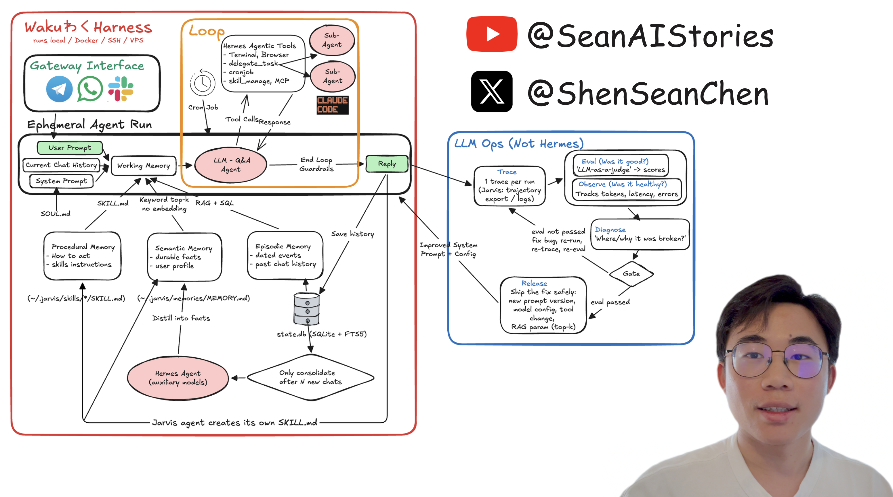

<picture>
  <source media="(prefers-color-scheme: dark)" srcset="docs/brand/gogo-mark-on-dark.png">
  
</picture>

# gogo-agent

**A local-first AI agent harness you actually own — the loop, the memory and the eval, running on your machine.**

gogo-agent is a small, readable codebase that shows the four pieces every
serious agent is made of: **Harness · Loop · Memory · Eval**. No framework hides
the parts that matter — each one is plain Python you can read, change and keep.

- **Local-first.** Your state lives in one SQLite file under `~/.gogo/`. Open it,
  read it, delete it. It is yours, and nothing leaves your machine unless you
  connect something yourself.
- **The loop is ~95 lines** of plain Python: observe, reason, act, repeat. Step
  through it with a debugger.
- **Memory is the core feature.** Semantic, episodic and procedural memory, with
  a gate that decides *whether* to remember and a consolidation pass that
  decides *what* to keep.
- **Watch it think.** A local dashboard lights up every message as it flows
  through the harness, with a trace for every turn.
- **Eval built in.** Deterministic offline tests and LLM-as-judge runs side by
  side, with a release gate that blocks a tag on a regression.
- **Bring your own model.** Anthropic, OpenAI, Gemini, DeepSeek, OpenRouter and
  more — one dialect in the loop, a small adapter per provider.



> Every box on the whiteboard maps to a file — see [the architecture](docs/architecture.md).

## Quickstart

```bash
pip install gogo-agent
gogo                         # talk to your agent in the terminal
gogo dashboard               # …or the browser cockpit → localhost:7777
```

The first run tells you which key to set. To read the code and run from a
checkout instead:

```bash
git clone https://github.com/DAgogo04/gogo-agent && cd gogo-agent
uv venv && uv pip install -e .          # create the env + install the `gogo` command
cp .env.example .env                    # pick a provider, paste ONE key
uv run gogo                             # talk to your agent in the terminal
uv run gogo dashboard                   # …or the browser cockpit
```

**Try it.** Say *"Remember that Sam prefers morning meetings."* Quit, restart,
then say *"Book a meeting with Sam next week."* It remembers, and books the
morning. The memory is the same one file from every folder: `~/.gogo/state.db`.

New to it? [Getting started](docs/getting-started.md) walks the whole setup,
with a check at the end of every step.

## External memory, on your terms

The built-in memory is local files plus SQLite — no account, no server. If you
run an MCP server that publishes `memory.remember` / `memory.search` /
`memory.get`, add it to `~/.gogo/mcp.json` and gogo mirrors saved facts and
research reports there too. The server is discovered by capability, so any
compatible memory backend works; mark its entry `"memory": true` to name it
explicitly.

```bash
gogo mcp                      # list servers and the account each knows you as
```

See [integrations](docs/integrations.md) for remote servers, OAuth sign-in and
the MCP configuration format.

## What's inside

| Piece | In one line | Read more |
|---|---|---|
| **Harness** | gateways (terminal, dashboard, voice, Telegram, Discord, WhatsApp) and tools around one loop | [architecture](docs/architecture.md) |
| **Loop** | ~95 lines of plain Python: reason, act, repeat, with two ways to stop | [the tour](docs/tour.md) |
| **Graph** | opt-in structure around the loop, with a fail-open rule, when a task genuinely needs shape | [loop vs graph](docs/loop-vs-graph.md) |
| **Memory** | semantic, episodic and procedural (skills); a gate decides *whether* to remember, consolidation decides *what* to keep | [the tour](docs/tour.md) |
| **Eval** | deterministic tests and LLM-as-judge side by side, a release gate, a trace for every turn | [evals](docs/evals.md) |

**How is this different from ChatGPT or Claude Desktop?** Those are products
you *use*. This is a codebase you *own*: the loop, the memory schema, the gate
and the eval harness are all yours to read and change.

## Docs

| Read | For |
|---|---|
| [Getting started](docs/getting-started.md) | installing, the first run, optional integrations |
| [The tour](docs/tour.md) | the dashboard, things to try, the loop, graph workflows, skills |
| [Architecture](docs/architecture.md) | every box on the whiteboard, and the file behind it |
| [Integrations](docs/integrations.md) | voice, Telegram, calendars, MCP servers, external memory |
| [Commands](docs/commands.md) | every `gogo` and `make` command |
| [Evals & tracing](docs/evals.md) | the two kinds of eval, the release gate, traces and spend |
| [Roadmap](docs/roadmap.md) | what is live, what is still a skeleton, upgrade paths |
| [Whiteboards](docs/README.md#whiteboards) | editable system-design charts, with builders that regenerate them |
| [Examples](examples/README.md) | short runnable example setups |

## License

The code is MIT — see [LICENSE](LICENSE). Bundled fonts are under the SIL Open
Font License; their license files ship with them under
`gogo/ops/static/fonts/`.
