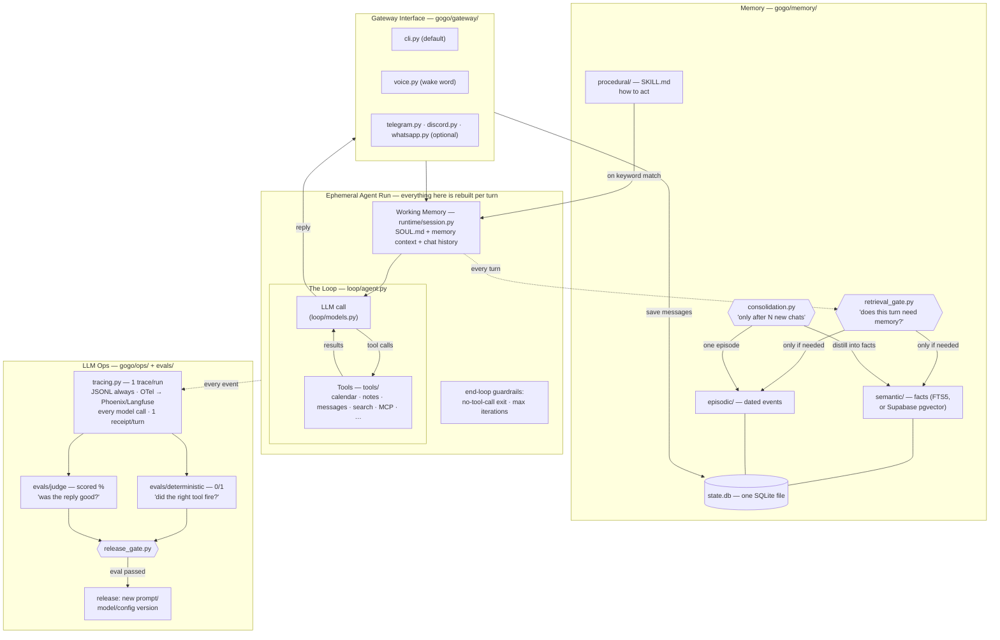
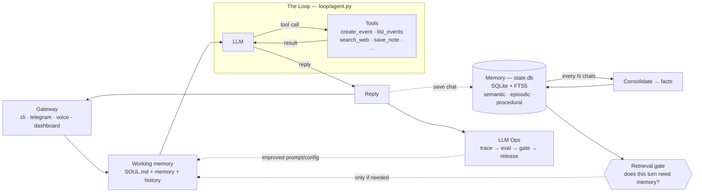

# Architecture — the whiteboard, refreshed

The same system as the two whiteboard diagrams from the previous videos
(the generic Harness/Loop/Memory/LLM-Ops one and the Hermes-specific one),
now with a file path on every box.

## The short version

### Which memories earn a slot

Retrieval finds the top facts for a message and, by default, puts all of them
in the prompt; consolidation keeps every fact the summariser proposes. With
`GOGO_SLOT_GATE=jev` and a `TYPESAFE_API_KEY`, Jev decides both
(`gogo/memory/slot_gate.py`, spec 005): one call scores every retrieved fact on
"how much does leaving this one out change the answer?" and keeps those at
0.5 or above, which scored 12 of 12 on the slot-gate conformance cases; and
each proposed fact is scored on whether a later answer would need it before
it is stored. Any failure keeps today's behaviour, so a slow judge never costs
a memory. The turn card says how many it kept.

### MEMORY.md vs state.db

Some assistants (e.g. Hermes) keep long-term memory as a single `MEMORY.md`
markdown file. Gogo keeps the *queryable* source in `state.db` (the `facts` and
`episodes` tables, keyword-searchable via FTS5) **and** regenerates a readable
`~/.gogo/MEMORY.md` mirror after every turn — so you get both: a real file you
can open, backed by a sturdy database. The dashboard's **Memory** tab is the
friendly view; the **Data** tab shows the raw `state.db` tables.

Each fact is also written to `~/.gogo/memory/<id>.md`, one file per fact, in
the same pass. That is the layout of Claude Code's memory, which the Gogo
Memory importer already uploads one memory per file. Episodes, `MEMORY.md` and
`state.db` are never written there (spec 003).

### Kept facts are written to files (and optionally an external memory server)

Each fact is written to `<home>/memory/<id>.md`, one file per fact, right
after it is stored in SQLite. When a user-configured MCP memory server is
connected, `app.py` can give consolidation a `remember` callable, and
consolidation sends every fact it keeps with `memory.remember` (kind `fact`,
or `reference` for company research) right after storing it locally
(spec 006). The summariser also keeps research findings
(companies, products, markets, prices, launches) and flags a batch that is
company research. Facts from a flagged batch go to scope
`project:Company brain`; all other facts go to scope `global`. The
`consolidation` event lists the kept facts, with the external server's id
when it returned one.

The `facts` table records each pending send with `synced = 0` and the scope.
A failed send is logged and never fails the turn, and the next consolidation
sends pending facts before new ones. Each kept fact in the event carries
`sent`: true when the server took it, false when it did not, and null without
an external server. When `sent` is false, the chat's card reads "Kept on this
agent only" and says the server did not answer, so neither claims a fact it
never stored. Locally consolidation runs every 6 exchanges; without a
connected server, nothing is sent.

### Research reports are saved as memory

The bundled `research-report` skill defines the gogo-report v1 format
(spec 007): one Markdown document whose first line is
`<!-- gogo-report v1 -->`, with fixed sections and fenced JSON blocks
(`gogo-metrics`, `gogo-chart`, `gogo-compare`, `gogo-timeline`,
`gogo-sources`). The format is frozen; a new component is a new block name.
When a turn's reply has that marker on a line of its own,
`gogo/memory/reports.py` keeps the report as one `semantic` memory, scope
`project:Company brain` for company or market research and `global`
otherwise. The chat reply becomes the sentences before the marker plus
"Report saved", the turn emits a `report` event `{title, memory_id, scope,
summary}` before `done`, and the chat log keeps the short reply with the
card in its meta. The dashboard's chat draws that card (title, summary
bullets), and under it the facts a `consolidation` event says the turn kept
(spec 008). The report stays in your local database and in one file per
fact under the home directory.

A turn saves at most one report. The model's own `memory_remember` tool
refuses a body holding the marker line, and if a report was saved by the
model anyway, `save` sends nothing more and the card points at that memory.
The skill says to name only the "treg cost" and never a total: the receipt
is the one place a turn's total is shown.

### Research reads the company brain first

A turn is research when the `research-report` skill matches its message:
research on companies, competitors or markets, or a request to save a brief,
summary or snapshot built from tool results ("save an audience brief to the
Company brain"). With an
external memory server configured, `gogo/memory/brain.py` runs `memory.search` twice before
the model's first call (spec 009): once for the subject (the message without
words like "research" and "the"), in every scope, and once for earlier
reports, kind `semantic`. The hits go into the system prompt under "What the
company brain already knows", each with its date and id, reports first, and
the skill says to start there, name the earlier report and its date, and
research only what is missing or older than 30 days. Each earlier report
found is read once with `memory.get` and goes into the prompt as its digest
(title, Summary, key numbers, at most 1,500 characters), and the loop cuts a
whole report the model fetched itself to its digest before each later call
(`reports.shrink_read`, passed to `run_loop` as `trim`). The same `trim`
step then cuts every other tool result longer than 4,000 characters that the
model has already read to its first 2,000 characters and a note
(`gogo/loop/trim.py`); the newest results are always sent whole, and the trace
keeps every output whole. Each search is shown as
an external memory search tool call, the `done` payload and the turn's meta
carry them as `used`, and the
dashboard's chat lists them under "Used from memory": a report as its title
and first Summary line, any other memory as its snippet without fenced code
or JSON (a search snippet of a report often starts inside its Sources
block). The searches are not
folded into the chat log. A failed search is logged and skipped; the turn
goes on without it.

Consolidation never keeps the assistant's own operating state: a treg balance,
credits, billing, a 402 or 429, a rate limit, a tool error or a token count
is stale within the hour and says nothing about the person (2026-10-05:
"User's treg balance is $0.759 USD" was kept). The summariser is told so,
and `consolidation.is_ops_state` drops whatever it proposes anyway.

A turn that answered from memory does not keep that memory again. The answer
repeats what it read, so the summariser proposes it as new facts (2026-10-05:
one recall turn kept five copies of a report's findings).
`app.py` passes consolidation everything the turn read (what the retrieval
gate found, what research read first, and what the model's own external
memory searches, gets and recalls returned), the summariser is shown it, and
`consolidation.restates` drops a proposed fact that has a number or a date
and whose every name, number and date is already in it. A new fact the person
adds ("Zep raised again in 2026") has something the memory does not, so it is
kept; a fact with no number is never dropped by this check.

A turn that saved a report consolidates with it (spec 009 B): the summariser
is told the findings are in the report, a fact whose subject the report names
is dropped, and at most two facts are kept, as the person's own (scope
`global`). A laptop batch that holds an earlier report turn reads that report's
title and summary from the chat log's meta.

Each tool card shows `cost_usd` and the provider when the result carries them
(for example a treg call on your own account). `GOGO_UNAVAILABLE_TOOLS` names
tools the deployment does not offer, and the system prompt says not to call
them.

### The turn receipt

Every reply in the chat ends with one line that says what the turn did and
cost (spec 011), for example `claude-sonnet-5 · 12.4k in / 1.9k out · $0.064
est | treg 2 · $0.030 | memory 4 used · 2 kept · report saved | $0.094`.
Clicking it opens a table of the same numbers, alongside the kept facts
and the report the turn saved. `gogo/ops/receipt.py` builds it once
from the turn's own events; the `done` payload carries it as `receipt`, the
chat log keeps it in `meta.receipt`, and the trace gets one `receipt` event.
It holds names, counts, dollars and ids, and never a tool's arguments or
output.

Every `tool` trace line (schema `v: 2`, spec 012) carries the turn's
`turn_id`, its `source` (`treg`, `gogo_memory`, `local` or `mcp:<server>`),
its span kind (`tool`, `retrieval` or `memory_write`), `duration_ms`, `ok`
and on a failure `error`, `cost_usd`, `endpoint_id` and `provider` when the
result names them, the external memory `query`, `results`, `memory_ids` and
`retrieval_trace_id`, and its `args` redacted and trimmed to 500 characters.
Every `llm` line carries `turn_id` and `cost_usd`. Where an OpenTelemetry
GenAI attribute exists, the OTel export uses it, mapped in one table
(`GENAI` in `gogo/ops/observability.py`). The dashboard's Observability page
(`GET /api/observability`) reads these lines, and reads a line written
before spec 012 with the same functions, leaving empty what it cannot derive.
Each turn it returns carries `scores`: the five turn checks of
`gogo/ops/turn_evals.py` (source `code`, value 1, 0 or null for n/a), run on
every read rather than stored, plus any `score` event written for the turn:
the AI judge's, written once when someone presses "Judge this turn" (spec
015, `docs/evals.md`). The judge's call carries an `X-Gogo-Turn` id of its
own, so the metering proxy answers its exact charge.

Every turn has a `turn_id`, written on the trace's `turn_start` and
`turn_end`, on each `usage.jsonl` row and in the chat log's meta. Every model
call writes a `usage.jsonl` row and an `llm` event: the loop's with `kind`
`loop`, and the small-model calls around it with `gate`, `consolidation`,
`report`, `triage` or `quick` (`metered()` in `gogo/ops/tracing.py`). When a
turn hits `max_iterations`, the loop makes one more call with tools off and
its `llm` event has `kind` `final` and `final_answer: true`; the waterfall's story line shows
it as "limit reached → final answer".

Model dollars are an estimate from `gogo/ops/pricing.py`, marked "est".
A connected provider that reports an exact charge can replace the estimate
for a turn; when it does not, the estimate stands.

## Which file is which

- `gogo/gateway/` — how text gets in and out: `cli.py`, `voice.py` (wake word),
  `telegram.py`, `discord.py` and `whatsapp.py`, started by `runner.py` and
  `supervisor.py`. Gateways only move text.
- `gogo/runtime/session.py` — working memory for one turn: SOUL.md, memory
  context and chat history.
- `gogo/loop/agent.py` — the loop. `loop/models.py` — pluggable providers over
  two wire formats.
- `gogo/graph/` — the engine, node factories and `workflows/` (triage): opt-in
  structure around the loop. The loop never changes, a graph node can be a loop
  turn, and every failure fails open to the plain loop.
- `gogo/tools/` — what the agent can call: `calendar.py`, `google_calendar.py`,
  `apple.py`, `notes.py`, `messages.py`, `search.py`, `github.py`,
  `workspace.py`, `memory_admin.py`, the MCP client and `experimental.py`.
  `registry.py` decides which are on.
- `gogo/memory/` — semantic (FTS5), episodic and procedural (SKILL.md) memory,
  plus `retrieval_gate.py` (does this turn need memory?) and
  `consolidation.py` (every N exchanges), `reports.py` (a research report
  is saved as one semantic memory) and `brain.py` (a research turn can read
  an external memory first).
- `gogo/ops/` — tracing (JSONL + OTel), the dashboard (localhost:7777),
  `release_gate.py`, and `compare_history.py` (the Compare arena's own JSONL
  scoreboard, never `state.db`).
- `gogo/ops/static/` — the dashboard frontend. Read
  [context/design-system.md](context/design-system.md) before changing how
  anything looks.
- `evals/deterministic/` (0/1, pytest) and `evals/judge/` (DeepEval, scored).
  The two never mix.
- `examples/` — small example setups; one folder per topic.
- `~/.gogo/` — runtime state: `state.db`, `calendar.ics`, `outbox/`, `traces/`.
  `GOGO_HOME` moves it; `make` sets it to the repo's own `.gogo/`, which is
  gitignored. `gogo/config.py` `resolve_home()` has the rules.
- `.env` — a model key is read from the environment, then the nearest `.env`
  from the working directory upward, then `<home>/.env`, the first one winning.
  A dashboard save writes to that nearest `.env` when one exists and to
  `<home>/.env` otherwise (`gogo/config.py` `env_write_target()`).
  `gogo/key_locations.py` reports those places to the setup page and to
  `gogo connections`, as paths and yes or no, never a value.

## Design decisions worth stealing

- **The gate before retrieval** (not retrieval on every turn): a cheap-model judge
  answers "does this message need the user's memory?" — saves latency and, more
  importantly, keeps irrelevant memories from biasing answers.
- **Consolidation is batched** ("after N chats"), asynchronous to the reply path,
  and loss-safe: if the summarizer fails, the chat log stays unconsolidated.
- **Deterministic evals and judge evals never mix.** One is a unit test, the other
  is a scored opinion. The release gate requires 100% of the first and a threshold
  on the second.
- **Every layer has a boring default and a documented upgrade** — FTS5 → pgvector,
  mock calendar → Google Calendar, JSONL → Phoenix/Langfuse. The default is always
  zero-signup.
- **Graphs wrap the loop, never replace it.** When a turn needs shape (parallel
  steps, explicit routing), an opt-in graph workflow (`gogo/graph/`) arranges nodes
  around the untouched loop — the `full_agent` node IS `run_loop`. Routers are plain
  code reading state a model wrote; every failure fails open to the plain loop; the
  dashboard renders the topology from the engine's own `describe()` so the picture
  can't drift. See `docs/agent-graphs-design.md`.

## What this deliberately is not

This tree is intentionally small, readable, and not a framework or
multi-agent system. (A graph workflow does not change that: its `agent_node`
is the same loop invoked as one step — no peer-to-peer agent messaging, and
execution follows the edges deterministically.) Everything runs locally on
your machine; memory lives in one local SQLite database plus one file per
fact under the home directory. Optional live data tools (for example `treg`,
once `gogo connect treg` has signed you in with your own key) run on your
own account. The dashboard can also be served as a bare chat column at
`/embed/chat` and framed by an external page; by default no page may frame
it (spec 008).
